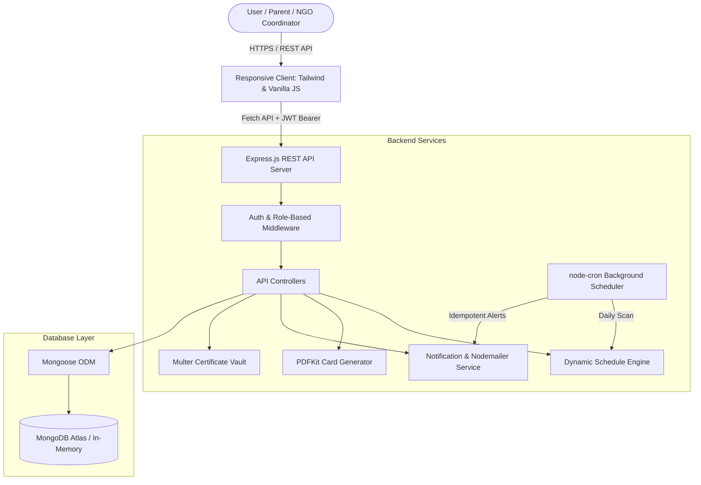

# VaxaGuard — Smart Vaccination & Immunization Tracker

> **Track. Protect. Stay Healthy — For Everyone.**

[](https://nodejs.org/)
[](https://www.mongodb.com/)
[](https://tailwindcss.com/)
[](https://jestjs.io/)
[](LICENSE)

**VaxaGuard** is a responsive, privacy-conscious full-stack web application designed to track and manage vaccination schedules, booster doses, and official immunization records across every stage of life. 

Built as an individual **BTech Mini Project** suitable for public GitHub submission and free-tier deployment, VaxaGuard supports individual families as well as authorized **Orphanages, Child-Care Institutions, and NGOs**.

---

## 📸 Visual Identity & Mockup Alignment

VaxaGuard is crafted using the reference UI mockup design system:
- **Primary Healthcare Blue:** `#0284C7` (Sky-600)
- **Deep Navy Headings:** `#0F172A` / `#1E293B`
- **Soft Teal Accents:** `#0D9488`
- **Status Green (Completed):** `#10B981`
- **Status Amber (Due Soon):** `#F59E0B`
- **Status Red (Overdue):** `#EF4444`

### Key UI Views Implemented:
1. **Public Landing Page:** Multi-generational healthcare hero, 4 age-group cards (Children, Adults, Seniors, Orphanages), feature highlights, and medical disclaimers.
2. **Sign Up & Login:** Tabbed authentication, role selection, 256-bit encryption, and 1-click evaluator demo accounts.
3. **Personalized Dashboard:** 4 real-time stat cards, dynamic upcoming vaccination queue, SVG circular completion ring, quick actions, and recent activity.
4. **My Family:** Profiles for children, adults, and seniors with live completion progress bars and quick dose logging.
5. **Orphanage / NGO Management:** Beneficiary cohort management, institution-wide coverage stats, care handover workflows, and aggregate reports.
6. **Individual Vaccination Schedule:** Dynamic date-of-birth schedule engine based on the Indian National Immunization Schedule (UIP), status badges, and dose completion.
7. **Add / Update Record Form:** Medical record logging with dose numbers, clinic, doctor, batch numbers, and digital certificate file upload.
8. **Vaccination Records & PDF Vault:** Filterable history and one-click printable **PDF Immunization Card** download.
9. **Reminders & Notification System:** Daily automated scheduler (`node-cron`), idempotent in-app alert center, and configurable lead-times.
10. **Nearby Vaccination Centers & Map:** Directory of accredited hospitals, PHCs, and pediatric clinics with radius filtering.

---

## 🛠️ Technology Stack

| Layer | Technologies |
| :--- | :--- |
| **Frontend** | HTML5, Tailwind CSS (Tailwind CDN v3), Vanilla JavaScript (ES6+), Fetch API, Lucide Icons |
| **Backend** | Node.js, Express.js (RESTful Architecture), Mongoose ODM |
| **Database** | MongoDB Atlas (Cloud) / Automated In-Memory MongoDB (`mongodb-memory-server` for zero-setup local execution) |
| **Security** | bcryptjs password hashing, JWT authentication, Express Rate Limiting, Helmet CSP, Multer file whitelisting |
| **Document Engine** | PDFKit for generating official printable Immunization Cards |
| **Automation** | node-cron background task scheduler, Nodemailer email alerts |
| **Testing** | Jest, Supertest integration suite |

---

## 🏛️ System Architecture



---

## 📂 Project Directory Structure

```text
vaxaguard/
├── client/                     # Frontend Application
│   ├── index.html              # Public Landing Page
│   ├── login.html              # Authentication & Demo Accounts
│   ├── register.html           # Registration Redirector
│   ├── dashboard.html          # Personalized Dashboard & Charts
│   ├── family.html             # My Family Management
│   ├── schedule.html           # Dynamic Vaccination Schedule
│   ├── organizations.html      # Orphanage / NGO Management
│   ├── records.html            # Records & PDF Certificates
│   ├── reminders.html          # Alerts & Notification Center
│   ├── vaccine-directory.html  # Searchable Vaccine Encyclopedia
│   ├── centers.html            # Nearby Vaccination Centers
│   ├── settings.html           # Profile & Health Diagnostics
│   ├── css/
│   │   └── style.css           # Design Tokens, Glassmorphism & Animations
│   └── js/
│       ├── api.js              # Fetch API Client & Session Manager
│       ├── auth.js             # Sign In, Sign Up, & Demo Logins
│       ├── components.js       # Shared Sidebar, Topbar, Modals & Toast
│       ├── dashboard.js        # Dashboard Metrics & Progress Donut
│       ├── family.js           # Family Member Filtering & Progress
│       ├── schedule.js         # Schedule Table & PDF Card Download
│       ├── organizations.js    # NGO Cohorts & Care Handover
│       ├── records.js          # Vaccination Records & Filters
│       ├── reminders.js        # In-App Alerts & Notification Toggles
│       ├── vaccines.js         # Vaccine Directory Search
│       └── centers.js          # Centers & Distance Filtering
├── server/
│   ├── src/
│   │   ├── config/
│   │   │   └── db.js           # MongoDB Atlas & In-Memory Fallback
│   │   ├── controllers/        # REST Controllers (Auth, Family, Records, etc.)
│   │   ├── middleware/         # JWT Auth, Roles, Error Handler, Multer Upload
│   │   ├── models/             # Mongoose Models (User, Dependent, Vaccine, etc.)
│   │   ├── routes/             # Express API Routes
│   │   ├── services/           # Dynamic Schedule Engine, PDF & Notifications
│   │   ├── jobs/
│   │   │   └── scheduler.js    # Automated node-cron Due Date Scanner
│   │   ├── utils/
│   │   │   └── seedData.js     # Verified UIP Starter Dataset & Demo Seed
│   │   ├── app.js              # Express App & Security Configuration
│   │   └── server.js           # HTTP Server Entry Point
│   ├── tests/
│   │   └── api.test.js         # Integration Test Suite (11 Tests)
│   └── uploads/                # Protected Certificate Storage (gitignored)
├── .env.example                # Environment Variable Template
├── .gitignore                  # Git Ignore Configuration
├── package.json                # Dependencies and NPM Scripts
└── README.md                   # Project Documentation
```

---

## ⚡ Quick Start & Local Installation

### Prerequisites
- **Node.js**: v18.0.0 or higher
- **NPM**: v9.0.0 or higher
- **MongoDB**: Optional (VaxaGuard automatically starts an in-memory MongoDB instance with pre-seeded data if no `MONGODB_URI` is provided!)

### 1. Clone & Install
```bash
git clone https://github.com/your-username/vaxaguard.git
cd vaxaguard
npm install
```

### 2. Environment Configuration
Copy the `.env.example` file to `.env`:
```bash
cp .env.example .env
```
*(Leave `MONGODB_URI` blank to run instantly using zero-setup in-memory database, or paste your MongoDB Atlas connection string).*

### 3. Start the Application
```bash
npm start
```
The server will boot, connect to MongoDB, seed verified vaccines and demo family data, and launch:
- 🛡️ **Web Application:** `http://localhost:5000`
- 🏥 **Health Check API:** `http://localhost:5000/api/health`

---

## 🔑 Demo Accounts for Evaluators

VaxaGuard includes pre-seeded demo accounts with rich historical data matching the mockup panels:

| Role | Email | Password | Features Accessible |
| :--- | :--- | :--- | :--- |
| **Parent (Family Account)** | `vyshali@example.com` | `vaxaguard123` | Dashboard stats, Aarav's schedule, PDF card export, Reminders |
| **NGO / Orphanage Coordinator** | `hopehome@example.com` | `vaxaguard123` | Hope Home Orphanage, 5 beneficiaries, Care handover, Aggregate reports |

*(You can also click the 1-Click Demo buttons on the login page to sign in immediately without typing).*

---

## 🧪 Automated Testing

VaxaGuard includes an end-to-end integration test suite using **Jest** and **Supertest**.

Run tests:
```bash
npm test
```

### Verified Test Cases:
1. `POST /api/auth/register` — User creation and bcrypt password hashing
2. `POST /api/auth/login` — JWT token generation with valid credentials
3. `POST /api/auth/login` — Rejection of invalid passwords (401)
4. `POST /api/dependents` — Dependent creation and dynamic UIP schedule generation
5. `GET /api/dependents/:id` — Strict authorization boundary: cross-account access blocked (403)
6. `POST /api/records` — Vaccine administration and schedule dose marked `completed`
7. `GET /api/records/dependent/:id/pdf` — Binary stream of Immunization PDF Card
8. `createNotification` — Idempotent alert creation with unique deduplication keys
9. `POST /api/auth/register (NGO)` — Coordinator registration and organization profile binding
10. `POST /api/organizations/beneficiaries` — Beneficiary intake and cohort schedule tracking

---

## 🚀 Free-Tier Cloud Deployment Guide

VaxaGuard is engineered for cost-free deployment on modern cloud platforms.

### Step 1: Database on MongoDB Atlas (Free M0 Sandbox)
1. Sign in to [MongoDB Atlas](https://www.mongodb.com/atlas).
2. Create a free **M0 Cluster**.
3. Under **Network Access**, add IP `0.0.0.0/0` (Allow access from anywhere).
4. Under **Database Access**, create a database user and password.
5. Copy your connection string:
   ```text
   mongodb+srv://<username>:<password>@cluster0.mongodb.net/vaxaguard?retryWrites=true&w=majority
   ```

### Step 2: Backend on Render / Railway
1. Create a new **Web Service** on [Render](https://render.com).
2. Connect your GitHub repository.
3. Configure the settings:
   - **Environment:** Node
   - **Build Command:** `npm install`
   - **Start Command:** `node server/src/server.js`
4. Add Environment Variables:
   - `PORT`: `5000`
   - `NODE_ENV`: `production`
   - `MONGODB_URI`: `<your-atlas-connection-string>`
   - `JWT_SECRET`: `<your-random-32-char-secret>`
   - `CLIENT_URL`: `https://your-app.onrender.com`
5. Click **Deploy Web Service**.

### Step 3: Verify Deployment
Visit `https://your-service.onrender.com/api/health` to confirm the database status is `connected`.

---

## 🛡️ Security & Privacy Architecture

- **Password Hashing:** Passwords hashed using bcrypt with salt rounds = 10. Plaintext passwords are never stored or logged.
- **Strict Role-Based Access Control (RBAC):** Backend verifies resource ownership on every request. Changing an ID in the URL or payload returns `403 Forbidden`.
- **Private Certificate Vault:** Uploaded vaccination slips are stored outside public static directories and accessible only via authenticated JWT streams.
- **Idempotent Reminders:** Background cron jobs use composite deduplication keys (`${user}_${schedule}_${status}_${date}`) preventing notification spam.
- **Beneficiary Protection:** Institutional records avoid public indexing and record sensitive changes in audit logs.
- **Medical Disclaimer:** Explicit disclaimers clarify that VaxaGuard is an informational tracking tool and does not substitute professional medical advice.

---

## 🔮 Future Enhancements (Final-Year Project Roadmap)

- [ ] **AI-Assisted Pediatric Assistant:** Natural language vaccination FAQs and travel advisories powered by LLMs.
- [ ] **Multilingual Localization:** Support for regional Indian languages (Hindi, Telugu, Tamil, Bengali).
- [ ] **Offline PWA Support:** Service worker caching for immunization lookup without active internet.
- [ ] **Direct Hospital Integration:** FHIR / ABDM (Ayushman Bharat Digital Mission) compliance for automated clinic sync.
- [ ] **SMS Gateway Integration:** Real-time SMS via Twilio or Fast2SMS.

---

## 📄 License

This project is licensed under the MIT License — see the [LICENSE](LICENSE) file for details.

*Developed with pride for BTech Computer Science & Engineering.*
